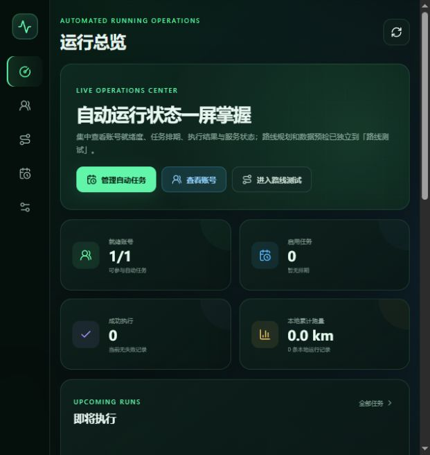
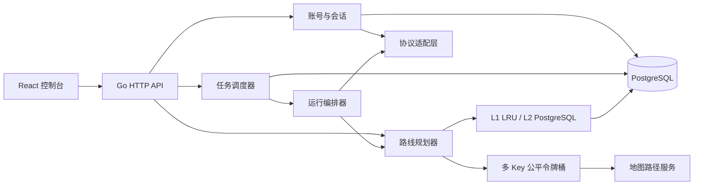

<div align="center">
  

  <p><strong>多账号智能跑步任务、地图路线编排与运行数据管理平台</strong></p>

  <p>
    
    
    
    
    
  </p>

  <p>
    <a href="#-项目亮点">项目亮点</a> ·
    <a href="#-快速开始">快速开始</a> ·
    <a href="#-系统架构">系统架构</a> ·
    <a href="#-配置参考">配置参考</a> ·
    <a href="#-参与贡献">参与贡献</a>
  </p>
</div>

---

## ✨ 项目简介

**EasyRun** 是一个采用 Go、React 与 PostgreSQL 构建的现代化跑步任务平台。它把账号会话、计划规则、校园区域、路线规划、任务调度、运行记录和系统配置集中到一个高科技风格的 Web 控制台中。

后端使用 Go 独立完成协议适配、签名加密、登录验证、资源同步、路线编排和任务执行；前端使用 React + TypeScript 提供响应式管理界面。系统支持多账号、多地图 Key、数据库持久化缓存以及可观测的任务工作池。

> 当前仓库处于 **Private Preview** 阶段，正在进行公开发布前的文档、测试和许可证整理。

<p align="center">
  
</p>

## 🚀 项目亮点

### 账号与会话

- 支持密码登录与短信验证码登录，远端验证成功后才持久化账号。
- 自动处理登录过程中的滑块挑战；短信验证码保留人工输入环节。
- 密码、`token` 与 `satoken` 使用独立 AAD 的 AES-256-GCM 加密保存。
- 接口返回会话失效后自动标记账号，并提供按保存凭据重新登录的流程。
- 自动同步账号绑定的跑步计划、校园区域和服务端历史记录。

### 计划与规则

- 直接读取计划返回的距离、配速、步频、步幅、有效日期和允许运动时段。
- 支持按公里数或按次数计算的计划，并处理每日、每周次数与里程上限。
- 在规则有效范围的中间 70% 内动态抽样，避免长期使用固定参数。
- 任务执行前重新核对服务端记录与规则额度，超出限制时记录明确原因。

### 路线规划

- 基于地图步行路径服务构建围栏内路网，并随机选择路网节点规划路线。
- 道路数据不足时，自动切换为围栏内场地路线生成器。
- 支持服务端打卡点作为必经节点；起点、终点与路线形状均不强制闭环。
- 通过距离误差、重复率、越界率和打卡点覆盖率综合选择候选路线。
- 多 API Key 独立令牌桶、全局公平调度、重试、`singleflight` 请求合并。
- L1 进程内 LRU 与 L2 PostgreSQL 持久化缓存协同工作。

### 自动任务

- 支持固定时间与计划规定时段随机两种调度方式。
- 支持多 Worker × 多线程并发，配置可在控制台热更新。
- 计划、区域和距离均按账号资源自动约束。
- `next_run_at`、执行状态、远端记录号和失败原因全部持久化。
- 请求与采样按照客户端时间轴渐进执行，不集中突发发送。

### 数据与可观测性

- 运行记录包含距离、配速、步数、步频、步幅、分段与地图轨迹。
- 内置一致性预检，展示状态解释与无效原因，而不是原始响应堆栈。
- 地图指标包含各 Key QPS、令牌发放、缓存命中、重试、排队和在途请求。
- 提供健康检查、运行配置、OpenAPI 描述和结构化请求日志。

## 🧱 技术栈

| 层级 | 技术 |
|---|---|
| 后端 | Go 1.23、标准库 HTTP、pgx、robfig/cron |
| 前端 | React 19、TypeScript、Vite、Leaflet、Lucide |
| 数据库 | PostgreSQL 17 |
| 地图 | 高德地图 Web 服务 + 地图瓦片展示 |
| 安全 | AES-256-GCM、独立 AAD、系统凭据隔离 |
| 推理 | 可选 Windows x64 CGO + MNN 本地人脸模型 |
| 部署 | 单二进制嵌入前端、Docker Compose、Windows 本地脚本 |

## 🗺 系统架构



一次自动任务的主要流程：

```text
读取账号会话 → 校验计划与额度 → 获取起跑上下文/打卡点
→ 生成候选路线 → 按真实时间轴生成与发送数据
→ 完成结算 → 保存执行结果与远端记录号
```

## 📦 快速开始

### 方式一：Docker Compose

准备环境：Docker Engine 24+、Docker Compose v2。

```bash
git clone https://github.com/Zolohacker/EasyRun.git
cd EasyRun
cp .env.example .env
```

编辑 `.env`，至少配置：

```dotenv
ACCOUNT_MASTER_KEY=BASE64_ENCODED_32_BYTE_KEY
MAP_API_KEY=YOUR_WEB_SERVICE_KEY
POSTGRES_PASSWORD=USE_A_RANDOM_ALPHANUMERIC_PASSWORD
```

生成 32 字节主密钥：

```bash
openssl rand -base64 32
```

启动：

```bash
docker compose up -d --build
```

访问：<http://127.0.0.1:8080/>

### 方式二：Windows 本地运行

准备环境：Go 1.23+、Node.js 20+、PostgreSQL 17 客户端工具。

```powershell
git clone https://github.com/Zolohacker/EasyRun.git
Set-Location EasyRun

# 首次初始化本地数据库与加密主密钥
.\scripts\local-db.ps1 init

# 构建并启动
.\scripts\start-local.ps1 -Rebuild
```

本地数据库仅监听 `127.0.0.1:56432`。生成的 `.env.local`、数据库目录、日志、备份和账号主密钥均已被 Git 忽略。

常用维护命令：

```powershell
.\scripts\local-db.ps1 status
.\scripts\local-db.ps1 start
.\scripts\local-db.ps1 backup
.\scripts\stop-local-db.ps1
```

## 🧭 基本使用

1. 打开「账号矩阵」，选择密码或短信验证码方式添加账号。
2. 登录完成后等待计划、校园区域和账号资料自动同步。
3. 在「路线测试」验证区域路网、目标距离和候选路线。
4. 在「自动任务」选择账号、计划、区域、调度时间和运行距离。
5. 在「运行总览」查看排期、执行状态与服务健康度。
6. 在账号历史记录中查看单次详情、预检结论和地图轨迹。

## ⚙️ 配置参考

| 环境变量 | 默认值 | 说明 |
|---|---:|---|
| `HTTP_ADDR` | `:8080` | HTTP 监听地址 |
| `DATABASE_URL` | 必填 | PostgreSQL DSN |
| `POSTGRES_DB` | `easyrun` | Docker Compose 数据库名 |
| `POSTGRES_USER` | `easyrun` | Docker Compose 数据库用户 |
| `POSTGRES_PASSWORD` | 必填 | Docker Compose 数据库密码，建议使用随机字母数字 |
| `DATABASE_MAX_CONNS` | `12` | 数据库最大连接数 |
| `ACCOUNT_MASTER_KEY` | 必填 | Base64 编码的 32 字节账号加密主密钥 |
| `MAP_API_BASE_URL` | `https://restapi.amap.com` | 地图 Web 服务根地址 |
| `MAP_API_PATH` | `/v3/direction/walking` | 步行路径接口 |
| `MAP_API_KEY` | 可选 | 首次启动写入数据库的地图 Web 服务 Key |
| `MAP_API_QPS` | `3` | 首个 Key 的默认独立 QPS |
| `MAP_API_BURST` | `2` | 每个 Key 的令牌桶容量 |
| `MAP_ROUTE_CANDIDATES` | `4` | 默认路线候选数，范围 1–8 |
| `AUTOMATION_WORKERS` | `2` | 初始 Worker 数 |
| `AUTOMATION_WORKER_CONCURRENCY` | `1` | 每个 Worker 的初始并发数 |
| `AUTOMATION_RUN_TIMEOUT` | `90m` | 单次任务总超时 |
| `PROTOCOL_BASE_URL` | 见示例配置 | 协议服务根地址 |
| `PROTOCOL_ENVIRONMENT` | `9` | 客户端环境值 |
| `PROTOCOL_TIMEOUT` | `20s` | 单个协议请求超时 |
| `FACE_ENGINE_LIBRARY_PATH` | 空 | Windows x64 本地模型运行库路径 |
| `FACE_MODEL_PACK_PATH` | 空 | 本地模型归档路径 |
| `FACE_DETECT_PIXEL_SIZE` | `320` | 检测输入级别：160、320 或 640 |

完整示例见 [`.env.example`](./.env.example)。地图 Key、各 Key QPS、Worker 数和线程并发也可在「系统配置」页面持久化并热更新。

## 🔌 API 与协议基线

当前适配基线：

| 字段 | 值 |
|---|---|
| App Version | `8.7.9` |
| Build Version | `26101910` |
| App Code | `SD001` |
| Platform | `2` |
| Environment | `9`（Pro） |

主要管理 API：

- `GET /healthz`
- `GET /api/v1/config`
- `GET /api/v1/map/metrics`
- `GET|PUT /api/v1/system/settings`
- `GET|POST /api/v1/accounts`
- `GET /api/v1/accounts/{id}/records`
- `GET /api/v1/accounts/{id}/records/{record_id}`
- `GET /api/v1/plans`
- `GET /api/v1/areas`
- `POST /api/v1/routes/plan`
- `GET|POST /api/v1/jobs`
- `POST /api/v1/jobs/{id}/run`
- `GET /api/v1/executions`

完整定义见 [`frontend/public/openapi.json`](./frontend/public/openapi.json)。

## 🧩 项目结构

```text
EasyRun/
├─ cmd/server/              # 依赖装配、服务启动与优雅退出
├─ frontend/                # React + TypeScript 控制台
├─ internal/activity/       # 轨迹、分段、汇总与一致性校验
├─ internal/automation/     # 调度、任务领取与工作池
├─ internal/faceengine/     # 可选的本地模型推理封装
├─ internal/geo/            # 测地线、补点与路径采样
├─ internal/httpapi/        # REST API 与嵌入式前端
├─ internal/mapapi/         # 地图限流、缓存、重试与请求合并
├─ internal/platform/       # 账号、计划、区域和任务模型
├─ internal/protocol/       # 登录、签名、加密与运行协议
├─ internal/runner/         # 会话、同步和运行提交编排
├─ internal/securestore/    # AES-GCM 凭据保险箱
├─ internal/store/          # PostgreSQL 迁移与仓储
└─ scripts/                 # Windows 本地开发脚本
```

## 🛠 开发与验证

```powershell
# 前端类型检查与生产构建
Push-Location frontend
npm ci
npm run build
Pop-Location

# Go 格式化、静态检查、测试与构建
gofmt -w cmd internal
go vet ./...
go test ./...
go build -buildvcs=false -trimpath -o .\bin\easyrun.exe .\cmd\server
```

地图调度器包含竞态测试，修改密钥池、缓存或并发逻辑后建议额外执行：

```powershell
go test -race ./internal/mapapi
```

## 🔐 数据与密钥

- 不要提交 `.env`、`.env.local`、数据库目录、备份、日志、模型包或真实账号数据。
- 生产环境应使用独立随机的 `ACCOUNT_MASTER_KEY`，并在受控的密钥管理系统中保存。
- 地图 API Key 在 PostgreSQL 中使用 AES-GCM 加密保存，接口只返回掩码。
- 发布日志、截图或问题报告前，请移除账号、学号、手机号、轨迹与人脸图片。

## 🧭 Roadmap

- [x] 多账号与加密会话
- [x] 多地图 Key 独立 QPS 与公平调度
- [x] PostgreSQL 路线缓存
- [x] 计划规则与运行额度同步
- [x] 自动任务与执行记录
- [x] 历史轨迹地图与一致性预检
- [ ] Linux/macOS 本地模型推理支持
- [ ] 完整端到端测试与演示数据模式
- [ ] Prometheus 指标与 OpenTelemetry 链路追踪
- [ ] 国际化与移动端布局优化
- [ ] 首个公开版本与迁移指南

## 🤝 参与贡献

公开发布后欢迎通过 Issue 与 Pull Request 参与：

1. Fork 本仓库并创建功能分支：`git switch -c feat/your-feature`
2. 保持提交聚焦，并为行为变更补充测试
3. 确保 `go test ./...` 与 `npm run build` 通过
4. 提交 Pull Request，说明动机、实现和验证方式

## 📄 许可证与项目状态

仓库当前为私有预览，许可证将在正式公开前确定并补充。未随仓库提供的第三方服务、模型、品牌与数据，其权利归各自所有者。

EasyRun 与目标客户端及相关服务提供方不存在官方隶属或背书关系。请仅在你有权管理的账号、数据和环境中使用，并遵守适用规则。

---

<div align="center">
  <sub>Built with Go, React and PostgreSQL · EasyRun</sub>
</div>
