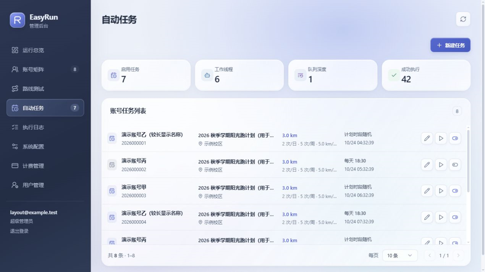
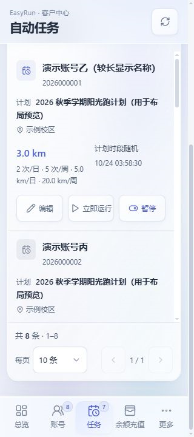

<div align="center">
  
  <p><strong>面向闪动校园的智能代跑平台</strong></p>
  <p>
    <a href="https://github.com/Zolohacker/EasyRun/releases/latest"></a>
    
    
    
    <a href="./LICENSE"></a>
  </p>
  <p>
    <a href="#features">功能亮点</a> ·
    <a href="#quick-start">快速部署</a> ·
    <a href="https://github.com/Zolohacker/EasyRun/releases/latest">下载发行版</a> ·
    <a href="./CHANGELOG.md">更新日志</a> ·
    <a href="#docs">文档</a>
  </p>
</div>

<a id="support"></a>

## 支持维护

**如果希望我持续维护项目、跟进闪动校园版本更新，请捐赠支持。**

USDT · TRON（TRC20）：

```text
TSuL6W7SsLJpWkYkJSdXP64LGetttttttt
```

请核对网络和完整地址。捐赠自愿，**此地址不是平台客户的充值地址**。

<a id="features"></a>

## 功能亮点

一个工作台管理账号、计划、路线、任务和记录，支持个人使用与可选客户前台。

**当前适配：闪动校园 Android `8.7.9` / Build `26101910`。** 其他版本未承诺兼容。

| 功能 | 重点 |
| --- | --- |
| 多账号管理 | 密码 / 短信登录、设备机型与系统配对、会话维护、计划同步与记录查询 |
| 路线管理 | 地图手绘与自动规划；按账号、计划和区域保存，预览轨迹与长度 |
| 自动任务 | 固定时间或计划时段随机；执行前检查日 / 周次数和里程额度 |
| 客户与计费 | 分级权限、用户数据隔离；按次、按公里、完整计划套餐 |
| 下单与充值 | 下单预扣、未执行额度增减退款；USDT 专属地址、充值码、钱包归集 |
| 独立配置链接 | 帮他人下单后，在已付费范围内配置人脸、路线和参数；支持轮换与撤销 |
| 地图与性能 | 多 Key 独立 QPS、公平调度、PostgreSQL 持久化缓存 |
| 部署与维护 | 自动生成主密钥、随附模型、移动端适配、客户端强更门禁、平台在线更新 |

- **未配置地图 Key 也可使用手绘路线**；自动路线需在后台添加 Key。
- **成功后结算，不再次扣余额**；执行中和已结算部分不支持退款。
- **USDT 收款弹窗打开时每分钟检查到账**，关闭后停止发起新检查。

<a id="preview"></a>

## 界面预览

<p align="center"></p>

<details>
  <summary>任务列表与移动端</summary>
  <p></p>
  <p align="center"></p>
</details>

<a id="quick-start"></a>

## 快速部署

### Docker Compose

准备 Docker 与 Compose v2：

```bash
git clone https://github.com/Zolohacker/EasyRun.git
cd EasyRun
cp .env.example .env
```

先修改 `.env` 中的 **`POSTGRES_PASSWORD`** 为随机数据库密码，再启动：

```bash
docker compose up -d --build
```

访问 [管理后台](http://localhost:8080/admin)，设置超管密码并选择个人 / 商业模式。客户入口为 [客户前台](http://localhost:8080/app)，可在后台关闭。

首次使用只需：

1. 在「系统配置 → 地图与执行器」按需添加高德 **Web 服务 Key**，每个 Key 默认 **3 QPS**。
2. 添加账号、同步计划与区域，再配置路线和任务。
3. 备份数据库、`data/account-master.key` 和钱包助记词。

主密钥与钱包自动生成；地图 Key 在后台填写，随附模型自动加载，无需手填模型路径。公网部署使用 HTTPS，并设置 `COOKIE_SECURE=true`。

> 新部署默认开启主网 USDT 收款，自动归集默认关闭。测试网已验证到账与去重，**主网仍需自行小额验收**；详细步骤见 [钱包与计费文档](./docs/portal.md)。

### 二进制 / 源码

- **完整发行包**：[Windows amd64、Linux amd64 / arm64](https://github.com/Zolohacker/EasyRun/releases/latest)，包含前端、模型、运行库及校验文件；配置 PostgreSQL 后按 [启动说明](./docs/updates.md#启动方式) 运行。Linux arm64 本地推理仍待真实硬件验收。
- **源码开发**：见 [开发与测试](./docs/development.md)。全部配置项见 [`.env.example`](./.env.example)。

## 升级提醒

**v0.1.7 包含路线管理和预扣账务迁移。** 升级前备份数据库与主密钥，在任务空闲时更新；已有付费订单后，不要仅回滚到不支持预扣账务的旧程序。

已启用持久化程序卷的容器支持后台一键更新；旧容器需先完成 [迁移](./docs/updates.md#目录权限与容器更新)。升级保留数据库、数据和程序卷，**不要执行 `docker compose down -v`**。旧的人脸专用链接需在任务列表重新生成独立配置链接。

<a id="docs"></a>

## 文档与贡献

| 文档 | 内容 |
| --- | --- |
| [首次启动与备份](./docs/first-run.md) | 初始化、主密钥、数据卷与旧部署迁移 |
| [路线与下单配置](./docs/manual-routes.md) | 手绘路线、预扣 / 退款、独立配置链接 |
| [客户前台与计费](./docs/portal.md) | 邮件、充值码、钱包备份、归集与 Linux 推理 |
| [随机设备资料](./docs/device-profiles.md) | 机型与 Android 配对、资料来源与维护 |
| [版本与在线更新](./docs/updates.md) | 客户端强更门禁、守护进程、容器更新 |
| [开发与测试](./docs/development.md) | 本地构建、集成测试与贡献流程 |
| [更新日志](./CHANGELOG.md) | 各版本变更和升级说明 |

欢迎提交 [Issue](https://github.com/Zolohacker/EasyRun/issues) 或 Pull Request。请附复现步骤，移除密钥、账号、学号、手机号、人脸和真实轨迹等敏感数据。

## 许可证

自有源码采用 [MIT](./LICENSE)。**随附第三方模型另有非商业研究用途限制**，详见 [模型资源说明](./models/NOTICE.md)。本项目与闪动校园及相关服务提供方无官方隶属或背书关系。
